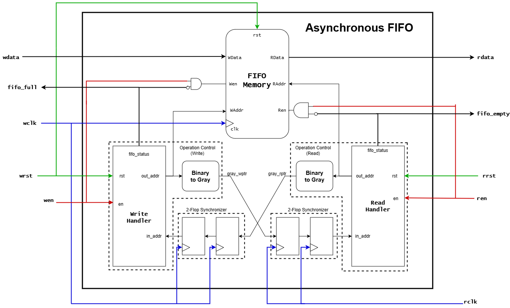
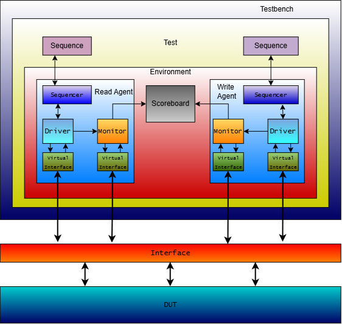

# Asynchronous FIFO Design & Verification using UVM
This project contains the RTL Design and Testbench of Asynchronous FIFO.

The Asynchronous FIFO is a dual clock circuit which reads and writes at different frequencies. It is suitable for systems which require safe crossing of multibit data from one clock domain to another.

## File structure
Following is the list of files used for design and verification purposes.


```├── README.md
├── design
│   ├── async_fifo.sv
│   ├── fifo_memory.sv
│   ├── operation_control.sv
│   └── single_flop.sv
└── testbench_uvm
    ├── base_test.sv
    ├── case0.sv
    ├── case1.sv
    ├── case2.sv
    ├── define.sv
    ├── dummy_diff.sv
    ├── fifo_env.sv
    ├── fifo_interface.sv
    ├── read_fifo_agent.sv
    ├── read_fifo_driver.sv
    ├── read_fifo_monitor.sv
    ├── read_fifo_seq.sv
    ├── read_fifo_sequencer.sv
    ├── read_fifo_transaction.sv
    ├── read_only.sv
    ├── reference_model.sv
    ├── scoreboard.sv
    ├── testbench.sv
    ├── transaction.sv
    ├── virtual_sequencer.sv
    ├── write_fifo_agent.sv
    ├── write_fifo_driver.sv
    ├── write_fifo_monitor.sv
    ├── write_fifo_seq.sv
    ├── write_fifo_sequencer.sv
    └── write_only.sv
  └── synth_logs
    ├── synthesis_report.log
    └── timing_report.log
```

## Design

### Overview

The Asynchronous FIFO supports parameterizable data and depth. The default configuration of the DUT is 32 x 16 (32-bit data with a depth of 16). The read and write resets are kept separate and synchronous to their respective clocks. This is to ensure independency between both the domains. Upon write reset, all the data inside the fifo memory gets reset. Subsequently, the write pointer and full flag are also reset. Upon read reset, only the read pointer is reset to the next position of wherever the write pointer is currently. When the full flag goes high, the writer should stop sending data to the fifo, as no more writes will take place until at least one read has been confirmed. Similarly, upon booting, empty flag will always be high until a write has been registered in the memory. Once all the data has been read the empty flag goes high again. When the empty flag goes high, the reader should stop expecting data from the fifo, as it will only be idly waiting, using unnecessary power. Thus, _ren_ should be deasserted during this period. Since the design is asynchronous, the following is very likely to happen:

- Fast read and slow write
  - When the reading system clock is faster than the writer clock, the reader will have to sit idle for most of the time during continuous reading. This will impact the latency of reader. 
  - The writer will have no issue writing to the fifo, as it will be very less likely that fifo will ever get full.
- Slow read and fast write
  - When the reading system clock is slower than the writer clock, the writer may become blocked by the continuous full signal from the fifo. This will impact the latency of the writer.
  - The reader will be very less likely to have any issues in this case.

In both the cases, one domain will always be likely to sit unnecessarily idle to send/receive data to/from the other. Such a tradeoff is necessary to ensure safe crossing of data from one clock domain to another.

### Working

The design works in the following way:
- The read and write pointers are first converted into gray pointers. Having multiple-bit transitions from one clock domain to another can result in glitches. Thus gray pointers are used so that transitions can be limited to a single bit and rest of the bits will be simply propagated.
- These gray pointers are sent to the opposite clock domain through 2-flop synchronizers. Once synchronized, these are fed to the respective handlers of the opposite domain
- For write domain, the synchronized input address _`rptr_synchronized`_ is compared with the next possible gray pointer. If the next gray pointer matches with this input, _`fifo_full`_ flag is asserted for next cycle and the next gray pointer is sent out. The same happens for _`fifo_empty`_ flag in read domain.
- If in the _`fifo_full`_ or _`fifo_empty`_ flag is asserted in the current cycle, the next pointer is not incremented. Only when the input synchronized pointer does not match the next incremented gray pointer, is the current pointer incremented and full or empty is deasserted.
- Before converting to gray pointer, each read and write pointer is fed directly from the handler to the fifo memory to read or write at the respective addresses.
- The fifo memory read and write enable are asserted only when the _`fifo_empty`_ and _`fifo_full`_ flags are deasserted and _ren_ and _wen_ are asserted respectfully.

#### Note
The matching at the read and write pointer happens differently. The read handler must assert empty when it catches up to the write pointer. Likewise, the write handler must assert full when it catches up to the read pointer. The read pointer can catch up to the write pointer when they both are in the same iteration, while the write pointer can catch up to the read pointer when they are in different iterations. To resolve this, an extra bit is added to the pointers to note whether there is any rollover. This extra bit is discarded when actually writing or reading from the memory.

The design is free of Lint and CDC unsafe paths.

## Design Specs

The following screenshots are the results obtained from design implemented in AMD Vivado 2024.2


The results obtained from Yosys/OpenSTA synthesis based on Sky130 library are included in synth_logs/

## Verification


### Overview
This project uses the Universal Verification Methodology(UVM) for verifying the DUT. UVM is a structured architecture of testbench, which nests multiple verification components like agent, scoreboard, environment, sequencer within it. The testbench has the "Test" which contains all the test components and parameters. Inside this "Test", there is an "Envionment" which contains agent and scoreboard. Agent again, contains the sequencer, the driver and the monitor. 

A typical UVM-based testbench works in the following way:
- Testbench decides which tests to run, and what should be the behaviour of primitive signals (clk, rst etc.)
- The test generates a set of sequence items, or the test conditions and inputs. These are fed to the sequencer.
- The sequencer decodes these sequences and forwards the inputs to the driver.
- The driver then passes these inputs to the DUT through an interface.
- The DUT does its computation from the inputs driven by the driver and generates the results.
- The results are sent from DUT to the monitor through the same interface. 
- The monitor stores these results along with the inputs from the driver and sends them to scoreboard.
- The scoreboard checks whether the DUT correctly calculated the results by comparing the output with a golden reference.


### Working
This project uses two sets of agents within a single environment. Each of these agents is exclusive to the read and write domain. Both these agents are used parallely with a single scoreboard. This scoreboard tracks the read and write domain simultaneuosly. The DUT is tested for the following:
- Read-only test
- Write-only test
- Long Parallel read and write tests
- Less read more write tests
- More read less write tests
- Random burst of read and write
- Single read/write test in parallel
- All the above tests with different clock ratios

The design is also tested with non standard parameter values (non-default parameters and non powers of 2)
The DUT passes all the above tests.